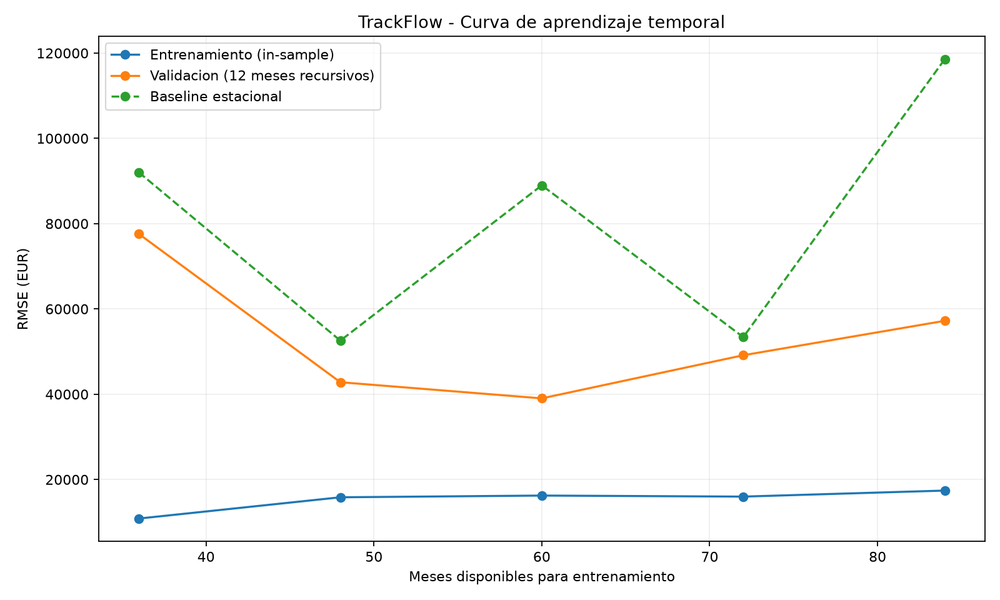

# Evaluacion formal del modelo de regresion - TrackFlow

## Objetivo

Evaluar la estabilidad y capacidad de generalizacion del
modelo Random Forest de prediccion de ingresos mensuales,
sin utilizar el periodo externo de prueba para seleccionar
hiperparametros.

## Contexto y datos

- Dataset: `data/raw/trackflow_sales.csv`.
- Objetivo: `revenue_eur`, mercado consolidado.
- Periodo de entrenamiento: 2016-2023 (96 meses).
- Prueba externa reservada: 2024-2025 (24 meses).
- Modelo: RandomForestRegressor de crecimiento interanual.
- Validacion: TimeSeriesSplit con 5 folds de 12 meses.
- Semilla del modelo: 42.

Los folds conservan el orden cronologico. Las variables
de entrenamiento se construyen solo con su historia.
Las predicciones de validacion son recursivas y nunca
incorporan los ingresos reales del fold como nuevos lags.

## Validacion cruzada del modelo original

| Metrica | Media EUR | Desviacion estandar EUR |
|---|---:|---:|
| MAE entrenamiento | 11,641.10 | 1,834.48 |
| MAE validacion | 44,288.44 | 14,523.20 |
| RMSE entrenamiento | 15,270.65 | 2,543.49 |
| RMSE validacion | 53,159.96 | 15,294.87 |
| RMSE baseline estacional | 81,102.93 | 28,129.30 |

El baseline repite las ventas del ultimo año conocido
para los doce meses de validacion.

## Curva de aprendizaje

La validacion cambia al aumentar el historial de
entrenamiento, pero no mejora de forma monotona.
Existe una brecha importante entre los errores.

**Advertencia metodologica:** el RMSE de entrenamiento
es in-sample de un paso y el de validacion es un
pronostico recursivo de doce meses. Por ello, la
diferencia entre curvas no permite atribuir por si sola
toda la brecha al sobreajuste.

## Diagnostico

**Clasificacion: indicios de overfitting (sobreajuste)
o dificultad de generalizacion a horizontes largos.**

La brecha entrenamiento-validacion justifica investigar
sobreajuste, pero el componente de acumulacion de
errores impide confirmarlo exclusivamente con esta curva.

No se observa un subajuste generalizado: el modelo
supera al baseline en el RMSE medio de validacion.

El aumento de datos disponibles tampoco garantiza una
mejora continua; debe evaluarse la estabilidad temporal.

## Experimento de regularizacion

Se mantuvieron los mismos folds, features y criterio
de evaluacion; solo cambio `min_samples_leaf`.

| min_samples_leaf | RMSE medio EUR | Desv. EUR | MAE medio EUR |
|---:|---:|---:|---:|
| 2 | 53,159.96 | 15,294.87 | 44,288.44 |
| 4 | 52,015.17 | 16,937.48 | 43,038.21 |
| 6 | 52,949.62 | 16,079.38 | 44,332.86 |

## Accion correctiva especifica

Probar min_samples_leaf=4 en lugar de 2. La validacion temporal muestra una reduccion del RMSE medio de 2.15%. Confirmar estabilidad antes de sustituir el modelo.

No se modifica automaticamente el modelo anterior.
La eleccion de hiperparametros se basa solo en los
folds de entrenamiento, no en el periodo 2024-2025.

## Justificacion de negocio

Para TrackFlow, una subestimacion de ingresos/volumen
podria reducir la capacidad planificada ante picos
de comercio electronico. Una sobreestimacion podria
provocar sobreasignacion de recursos.

El contexto no proporciona costos monetarios de estos
dos tipos de error; por eso no se afirma que uno sea
siempre mas caro. MAE es facil de interpretar en euros,
mientras que RMSE penaliza especialmente los errores
grandes durante periodos de alta actividad.

**Metrica principal: RMSE**, por el impacto de errores
grandes en la planificacion. MAE se reporta como
complemento interpretable.

## Evidencias y pruebas

- `regression_cv_folds.csv`: errores por fold.
- `regression_cv_summary.json`: media y desviacion.
- `regression_learning_curve.png`: curva temporal.
- `regularization_comparison.csv`: experimento.
- `tests/pipelines/test_regression_model_eval.py`:
  orden temporal y ausencia de fuga entre folds.

## Conclusion

El modelo supera al baseline, pero presenta variabilidad
entre periodos y una brecha de generalizacion que merece
investigacion. No se recomienda promocion automatica a
staging sin evaluar la accion correctiva y confirmar
las condiciones operacionales.
