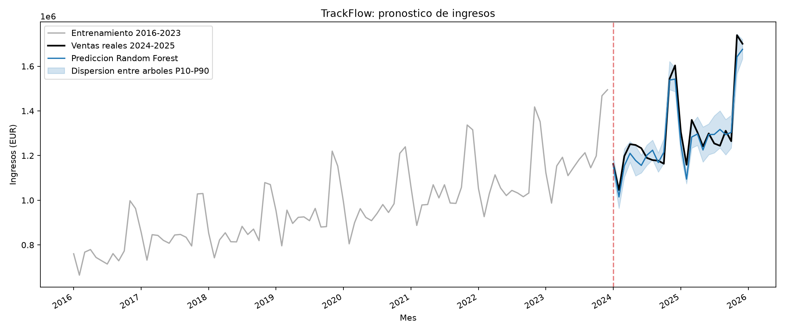

# TrackFlow — Pronóstico de ventas

## Objetivo

Predecir ingresos mensuales consolidados de TrackFlow para
2024–2025, usando exclusivamente información disponible
hasta diciembre de 2023.

## Dataset y procedencia

- Fuente: material académico de 4Geeks Academy,
  `ai-engineering-syllabus`.
- Archivo: `data/raw/trackflow_sales.csv`.
- SHA-256: `2b8c782efe182aa001db8044689e3d65e98b2cc17649b598cedb665e7d2f4c33`
- Periodo: enero 2016 a diciembre 2025.
- Registros: 120 meses consecutivos.
- Mercado: `consolidated`.
- Variable objetivo: `revenue_eur`.

## División temporal

| Conjunto | Periodo | Observaciones |
|---|---|---:|
| Entrenamiento | 2016–2023 | 96 |
| Prueba | 2024–2025 | 24 |

El entrenamiento supervisado utiliza 72 ejemplos,
porque los primeros 24 meses forman el historial
necesario para las variables causales.

No se utiliza una división aleatoria.

## Modelo

- Algoritmo: RandomForestRegressor.
- Árboles: 250.
- `min_samples_leaf`: 2.
- Semilla: 42.
- Objetivo interno: logaritmo del crecimiento
  interanual de ingresos.
- Variables: calendario, estacionalidad, rezagos
  y estadísticas calculadas con meses anteriores.
- Estrategia: pronóstico recursivo de 24 meses.

Los ingresos reales de 2024–2025 no se incorporan
al historial durante la predicción.

## Resultados en prueba

| Métrica | Resultado |
|---|---:|
| MSE (EUR²) | 2,330,679,429.74 |
| RMSE (EUR) | 48,277.11 |
| RMSE / ingreso mensual medio | 3.72% |
| R² | 0.9204 |
| Gini normalizado de regresión | 0.9196 |
| PSI sobre ingresos consolidados | 2.4237 |
| K² de normalidad de residuos, provisional | 0.8910 |
| Valor p del K² provisional | 0.6405 |

El MSE tiene unidades EUR². Se utiliza RMSE,
no MSE directamente, para la comparación
porcentual con el ingreso medio.

### Comparación con baseline

El baseline repite las ventas mensuales de 2023
en 2024 y 2025, sin consultar valores futuros.

- RMSE baseline: EUR 123,915.51
- RMSE Random Forest: EUR 48,277.11
- Reducción del RMSE: 61.04%

### Error absoluto por temporada

- Febrero: EUR 47,794.72
- Noviembre–diciembre: EUR 47,196.94
- Otros meses: EUR 37,761.04

### Banda de variabilidad

Se representa la dispersión P10–P90 entre
las predicciones de los árboles individuales.

Cobertura observada: 66.67%.

Esta banda **no es un intervalo predictivo calibrado**
y no garantiza cobertura del 80%.

## Limitaciones y advertencias

1. El PSI compara las distribuciones de ingresos
   consolidados entre train y test. No mide cambios
   de proporción entre Estados Unidos y España,
   porque el dataset no contiene filas separadas
   por mercado.

2. El Gini implementado es un índice normalizado
   de ordenamiento para regresión, no el Gini de
   clasificación.

3. **K2 Score pendiente de confirmación docente.**
   Provisionalmente se informa el K² de
   D'Agostino–Pearson sobre residuos. No se debe
   confundir con R² ni asumir que es la definición
   oficial del ejercicio.

4. Las métricas se calcularon sobre 24 meses
   de prueba. No garantizan desempeño futuro.

## Visualización



## Reproducibilidad

Desde la raíz del monorepo:

```bash
env -u VIRTUAL_ENV uv sync --project scripts/sales_forecast --python 3.12

env -u VIRTUAL_ENV uv run --project scripts/sales_forecast python scripts/sales_forecast/train.py

env -u VIRTUAL_ENV uv run --project scripts/sales_forecast python -m pytest tests/pipelines/test_sales_forecast.py tests/pipelines/test_sales_forecast_quality.py -q
```

## Artefactos

- `artifacts/random_forest_yoy.joblib`: modelo.
- `artifacts/forecast_2024_2025.csv`: predicciones.
- `artifacts/metrics.json`: métricas.
- `artifacts/forecast_vs_actual.png`: gráfico.

## Flujo Git

Rama: `feature/sales-forecast-model`.

Entrega mediante Pull Request hacia `main`,
pendiente de revisión del tech lead.
